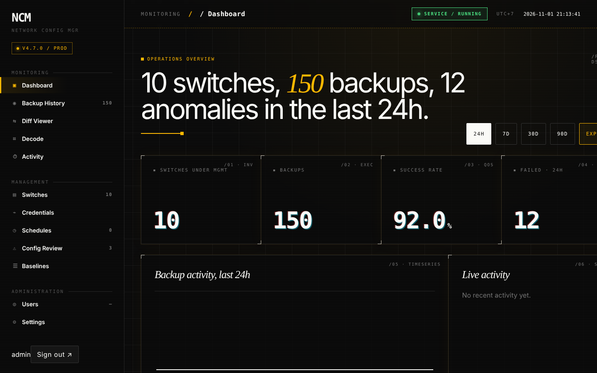
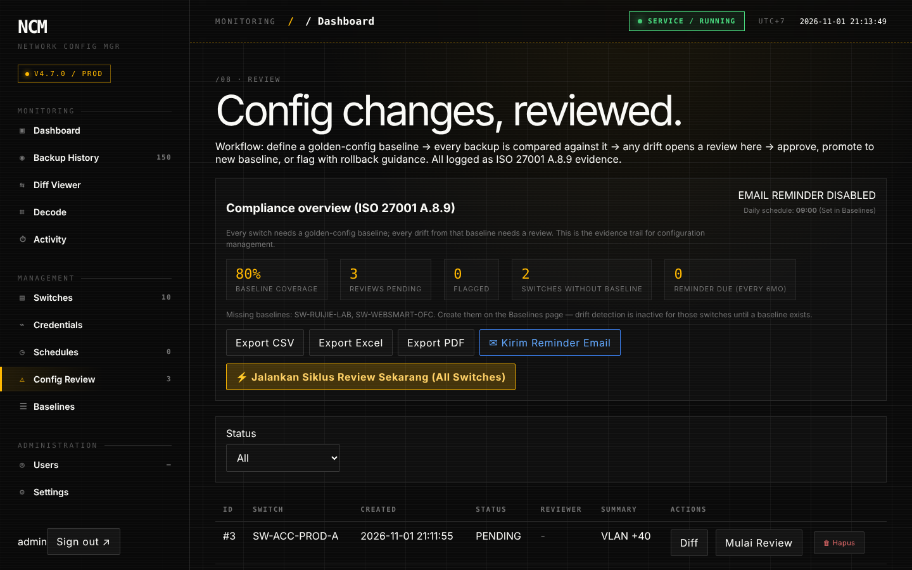
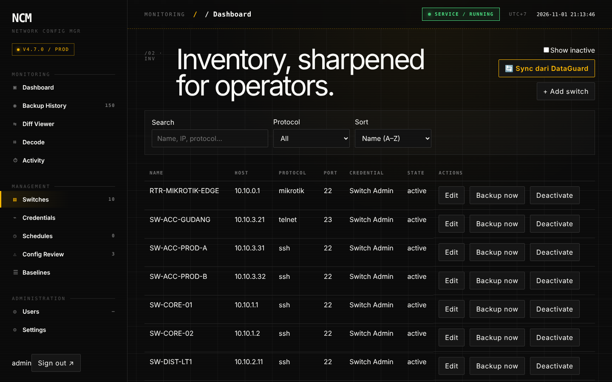
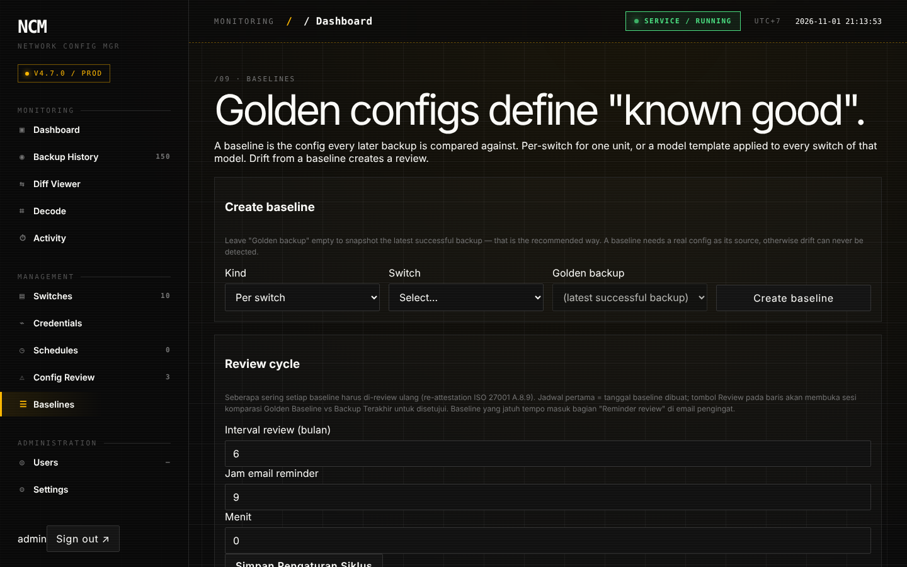
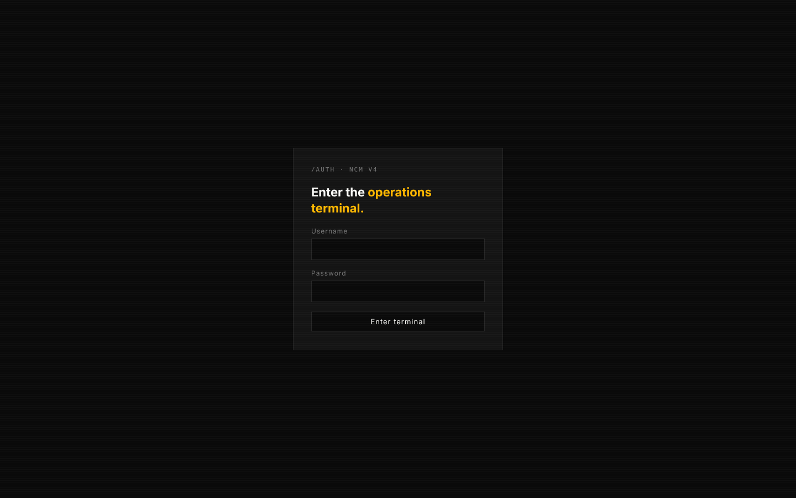

<p align="center">
  
</p>

<h1 align="center">NCM v4: Network Configuration Manager</h1>

<p align="center">
  <a href="README.md">English</a> · <b>Bahasa Indonesia</b>
</p>

<p align="center">
  Backup switch otomatis, review drift konfigurasi, dan bukti ISO/IEC 27001 A.8.9.<br/>
  Aplikasi desktop Windows dalam satu file executable (FastAPI + React).
</p>

<p align="center">
  
  
  
  
  
  
</p>

## Daftar isi

- [Tangkapan layar](#tangkapan-layar)
- [Kenapa NCM v4](#kenapa-ncm-v4)
- [Fitur](#fitur)
- [Perangkat yang didukung](#perangkat-yang-didukung)
- [Teknologi](#teknologi)
- [Arsitektur](#arsitektur)
- [Memulai](#memulai)
- [Build dari source](#build-dari-source)
- [Pengembangan](#pengembangan)
- [Data dan folder](#data-dan-folder)
- [API integrasi](#api-integrasi)
- [Pemecahan masalah](#pemecahan-masalah)
- [Dokumentasi](#dokumentasi)
- [Lisensi](#lisensi)

## Tangkapan layar



*Dashboard operasional*

| | |
|:---:|:---:|
| <br/>Review konfigurasi dan ringkasan kepatuhan ISO 27001 A.8.9 | <br/>Inventaris switch |
| <br/>Golden baseline dan siklus review | <br/>Halaman login |

Diambil dari antarmuka web dengan data switch dan backup demo.

## Kenapa NCM v4

Kebanyakan tim jaringan sudah mem-backup konfigurasi switch, tetapi jarang yang bisa menunjukkan kepada auditor bahwa konfigurasi itu benar-benar direview. NCM v4 menangani keduanya. Satu executable Windows menjalankan backup terjadwal lewat SSH, Telnet, atau SNMP, membandingkan setiap backup dengan baseline yang sudah disetujui, memasukkan perubahan ke antrean review, mengirim pengingat, dan mengekspor bukti ISO/IEC 27001 A.8.9. Saat jendela ditutup, aplikasi tetap berjalan di system tray.

Executable ini sekaligus server dan klien. Shell desktop menjalankan thread uvicorn yang menyajikan REST API dan antarmuka React di port 8443, jadi tidak ada yang perlu dipasang terpisah dan tidak butuh database eksternal.

## Fitur

### Backup dan pengelolaan drift

- Backup lewat SSH (asyncssh), Telnet (telnetlib3), dan WebSmart SNMP (v1/v2), dengan port dan kredensial per perangkat.
- Dukungan enable mode untuk CLI yang membutuhkannya, seperti Ruijie, dengan password enable tersendiri.
- Backup ganda MikroTik RouterOS: ekspor teks (`/export compact`) untuk diff dan file biner `/system backup` yang diunduh lewat SFTP.
- Golden baseline per switch atau per model. Baseline selalu menunjuk ke backup yang berhasil sebagai sumbernya; baseline tanpa sumber ditolak, sehingga deteksi drift tidak pernah mati diam-diam. Baseline yang sudah ada bisa diarahkan ulang ke backup yang lebih baru.
- Setiap backup dibandingkan dengan baseline-nya. Drift membuka review pending dengan ringkasan terstruktur (VLAN ditambah, dihapus, atau diganti nama, perubahan port, hostname) dan unified diff.
- Penampil diff punya tampilan decode, dan review bisa membuat perintah rollback CLI dari selisih antara baseline dan konfigurasi saat ini.
- Tombol Review di setiap baseline membandingkan konfigurasi golden dan terbaru kapan saja, bahkan saat switch sedang offline.
- Riwayat lengkap backup, diff, keputusan review, dan event audit, semuanya bisa dicari dan diekspor.

### Kepatuhan ISO/IEC 27001 A.8.9

- Siklus review dengan interval atestasi ulang dalam bulan yang bisa diatur (default 6) dan tanggal jatuh tempo yang akurat sesuai kalender.
- Alur review baseline tersendiri, termasuk atestasi untuk konfigurasi yang cocok dan tombol simpan siklus.
- Identitas reviewer dan tanggal review dicatat di setiap keputusan, dan catatan review bisa dihapus oleh pengguna yang berwenang.
- Panel kepatuhan: cakupan baseline, review pending dan yang ditandai, switch tanpa baseline, serta pengingat yang jatuh tempo.
- Laporan kepatuhan per switch dalam format CSV, Excel, atau PDF, termasuk tanggal review berikutnya.
- Ringkasan pengingat harian lewat email untuk review pending, baseline yang belum ada, dan atestasi ulang yang jatuh tempo. Pengingat berhenti setelah baseline diatestasi ulang.

### Notifikasi

- Email event dengan subjek yang jelas, misalnya:
  - `[NCM] BACKUP GAGAL — SW-CORE-01 (backup #123)`
  - `[NCM] BACKUP OK — SW-CORE-01 (backup #124) — config BERUBAH`
  - `[NCM] REVIEW PENDING #45 — SW-CORE-01 (drift terdeteksi)`
  - `[NCM] REVIEW APPROVED #45 — SW-CORE-01 — oleh admin`
- Pengaturan terpisah untuk alert backup gagal (aktif secara default), alert backup sukses (opsional), dan event review.
- Template HTML pengingat yang bisa diedit dengan `{{variabel}}`, dikirim sebagai multipart HTML dan teks, dengan tombol kirim pratinjau.
- Kanal Telegram dan webhook. Payload webhook ditandatangani dengan HMAC-SHA256.

### Keamanan

- Autentikasi JWT dengan access token berumur pendek dan refresh token, serta peran admin, operator, dan viewer.
- API key dengan scope (disimpan sebagai hash SHA-256, hanya prefix yang ditampilkan) untuk integrasi. Scope dan preset bisa diubah setelah key dibuat; key bisa dicabut atau dihapus permanen.
- Kredensial perangkat dienkripsi saat disimpan. Master key dilindungi Windows DPAPI.
- Penguncian akun dan kebijakan password.
- Audit log untuk setiap aksi sensitif: baseline, review, API key, pengaturan, dan retensi.

### Pengalaman desktop

- Menutup jendela tidak menghentikan backend dan scheduler; aplikasi tetap berjalan di tray. Menu tray Keluar adalah satu-satunya cara keluar sepenuhnya.
- Wizard setup saat pertama dijalankan: master passphrase, akun admin, dan alamat bind service. Default `0.0.0.0` membuka service ke jaringan lokal, dan wizard memberi peringatan soal itu.
- Antarmuka bergaya konsol operasi dengan tema gelap, grid perangkat langsung, grafik backup, dan penampil diff.

### Integrasi

- DataGuard: sinkronisasi nama dan model perangkat secara otomatis maupun sesuai permintaan.
- Endpoint baca untuk dokumentasi jaringan terstruktur, dipakai oleh DataGuard dan alat lain.

## Perangkat yang didukung

| Metode akses | Perangkat |
|---|---|
| SSH atau Telnet | Allied Telesis AlliedWare Plus dan Dell Networking, dengan parsing konfigurasi terstruktur; Ruijie dan switch CLI lain, dibandingkan sebagai diff teks biasa |
| WebSmart SNMP v1/v2 | Model Allied Telesis WebSmart, dengan parsing terstruktur |
| MikroTik RouterOS | Ekspor teks ditambah backup biner lewat SFTP |

Nama model dideteksi dari teks konfigurasi untuk perangkat Allied Telesis, Dell, Aruba, Cisco Catalyst, Juniper, MikroTik, dan Ruijie.

## Teknologi

| Lapisan | Teknologi |
|---|---|
| Backend API | Python 3.13, FastAPI, uvicorn, Pydantic v2 |
| Database | SQLite melalui SQLAlchemy 2 async (aiosqlite) |
| Shell desktop | PySide6 (Qt 6): jendela native, tray, dan WebView untuk SPA |
| Frontend | React 19, TypeScript, Vite, TanStack Query, wouter, recharts |
| Akses jaringan | asyncssh, telnetlib3, SNMP |
| Penjadwalan | APScheduler untuk backup, retensi, dan ringkasan pengingat |
| Keamanan | JWT, argon2, API key, Windows DPAPI |
| Laporan | reportlab (PDF), openpyxl (XLSX), csv |
| Notifikasi | SMTP (multipart HTML dan teks), Telegram, webhook |
| Packaging | PyInstaller, Inno Setup |
| Pengujian | pytest, pytest-asyncio, pytest-qt; Vitest dan Testing Library |

## Arsitektur

```
┌──────────────────────────────────────────────────────────────┐
│                 ncm-v4-desktop.exe (PyInstaller)             │
├──────────────────────────────────────────────────────────────┤
│  Shell PySide6            │  thread uvicorn (port 8443)      │
│  jendela · tray · login   │  FastAPI REST API + WebSocket    │
│        │                  │        │                         │
│        └──► SpaView (WebView) ──► React SPA (static bundel)  │
├──────────────────────────────────────────────────────────────┤
│  ServiceRuntime                                              │
│  BackupService · ReviewService · SchedulerService            │
│  RetentionService · Notifier (SMTP / Telegram / webhook)     │
├──────────────────────────────────────────────────────────────┤
│  Data: SQLite (app.db) + file backup di disk                 │
│  Jaringan: asyncssh · telnetlib3 · SNMP · klien MikroTik     │
└──────────────────────────────────────────────────────────────┘
```

## Memulai

Prasyarat: Windows 10 atau 11 dan akses jaringan ke switch lewat SSH, Telnet, atau SNMP.

1. Build atau dapatkan `dist\ncm-v4-desktop\ncm-v4-desktop.exe`.
2. Jalankan. Peluncuran pertama membuka wizard setup: master passphrase, akun admin, dan alamat bind.
3. Tambahkan switch dan kredensial, jalankan backup, lalu buat baseline dari backup tersebut.

## Build dari source

Prasyarat: Python 3.13 dan Node.js 20 atau lebih baru.

```powershell
# 1) Environment Python (pakai requirements lengkap; venv yang dipangkas membuat exe rusak)
python -m venv .venv
.\.venv\Scripts\Activate.ps1
pip install -r app_v4\requirements-v4.txt

# 2) Pasang dependensi frontend
npm --prefix app_v4/web install

# 3) Build bundel web dan exe desktop
.\installer\v4\build_app.ps1
# → dist\ncm-v4-desktop\ncm-v4-desktop.exe
```

`build_app.ps1` menyalin `dist\ncm-v4-desktop\data` (database dan master key) ke tempat sementara sebelum PyInstaller berjalan, lalu mengembalikannya sesudahnya. Bila menjalankan PyInstaller secara manual dengan `--clean`, backup dulu folder tersebut; tanpa itu kredensial terenkripsi tidak bisa dibaca lagi.

File lain di `installer\v4\`: `NCMv4.iss` (installer Inno Setup), `install_service.ps1` dan `uninstall_service.ps1` (menjalankan backend sebagai Windows service `NCMv4Backend`), dan `generate_cert.ps1` (sertifikat TLS).

## Pengembangan

```powershell
# Backend dengan dokumentasi API interaktif di http://127.0.0.1:8443/docs
python -m uvicorn app_v4.service.main:app --port 8443

# Dev server frontend
npm --prefix app_v4/web run dev
```

Pengujian:

```powershell
.venv\Scripts\python.exe -m pytest app_v4\tests -q   # backend
npm --prefix app_v4/web run test                     # frontend
```

### Struktur proyek

```
app_v4/
  core/            pengaturan, path, layanan auth, runtime settings
  data/            model SQLAlchemy dan repository
  net/             klien SSH, Telnet, WebSmart, MikroTik dan parser konfigurasi
  service/         aplikasi FastAPI, backup, review, scheduler, retensi, notifikasi
    api/           router REST (switches, backups, reviews, api_keys, network_doc, ...)
  desktop/         shell PySide6: jendela utama, tray, wizard setup
  web/             SPA React (Vite)
  tests/           suite pytest
installer/v4/      skrip build, spec PyInstaller, skrip Inno Setup, skrip service
Dokumentasi/       panduan pengguna, dokumentasi API, manual
```

## Data dan folder

| Path di samping exe | Isi |
|---|---|
| `data\app.db` | Database SQLite: switch, backup, review, audit |
| `data\master.key` / `master.dpapi` | Master key yang dilindungi DPAPI. Jangan pernah di-commit atau dibagikan |
| `backups\<switch>\<tanggal>\` | Snapshot konfigurasi dan file `.diff` |
| `data\runtime_settings.json` | Pengaturan notifikasi, siklus review, dan retensi |
| `logs\` | Log aplikasi yang dirotasi |

## API integrasi

Integrasi melakukan autentikasi dengan JWT atau API key ber-scope. Referensi interaktif tersedia di aplikasi pada menu Settings, dan di [Dokumentasi/Dokumentasi API.md](Dokumentasi/Dokumentasi%20API.md). `scripts/gen_api_reference.py` membuat ulang referensi di dalam aplikasi.

## Pemecahan masalah

| Masalah | Yang perlu diperiksa |
|---|---|
| Exe menampilkan ikon lama | Cache ikon Windows. Restart Explorer atau pin ulang shortcut |
| Backend tidak mau start | Pastikan `data\` bisa ditulis. Antivirus mungkin memblokir exe |
| Backup gagal karena AUTH atau timeout | Kredensial, password enable, dan konektivitas di menu Switches |
| Email pengingat tidak pernah sampai | Semua syarat: Enable notifications, Enable email reminders, host SMTP dan penerima |
| Komputer lain tidak bisa mengakses service | Alamat bind yang dipilih di wizard setup dan firewall Windows |
| Lupa master passphrase | Sengaja tidak bisa dipulihkan. Pulihkan dari backup atau mulai dari awal |

## Dokumentasi

- [Panduan pengguna](Dokumentasi/user_guide.md)
- [Dokumentasi API](Dokumentasi/Dokumentasi%20API.md)
- [Walkthrough](walkthrough.md) dan [rencana implementasi](implementation_plan.md)

## Lisensi

Proprietary, untuk penggunaan internal. Tidak ada izin untuk mendistribusikan ulang.

Dikembangkan oleh Yohanes Octavian Rizky ([@torpedoliar](https://github.com/torpedoliar)).
